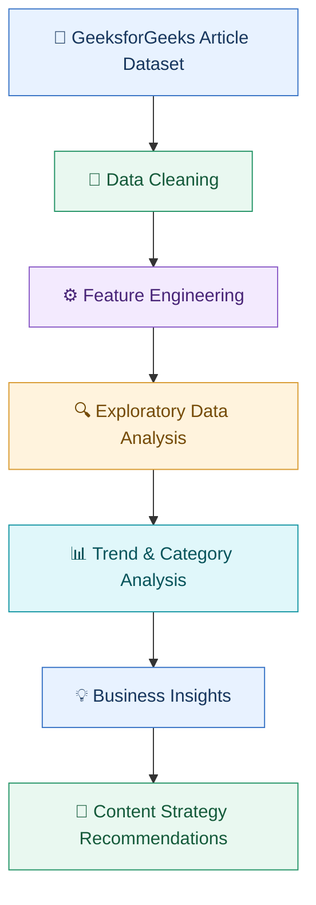

# 📊 GeeksforGeeks Content Trend Analysis

### Uncovering 12 Years of Content Evolution, Technology Trends & Publishing Insights

An end-to-end Python data analytics project exploring **170,000+ GeeksforGeeks articles** to understand content distribution, programming language popularity, publishing trends, and the evolution of technical education from 2014 to 2025.


<p align="center">
  
  
  
  
</p>

---

## 📌 About the Project

Every day, educational platforms publish technical content on programming, web development, interview preparation, artificial intelligence, and emerging technologies.

But publishing more articles doesn't automatically mean understanding what learners need.

**The real questions are:**

- 📚 Which technical topics receive the most content?
- 🐍 Which programming languages dominate educational resources?
- 📈 How has publishing activity changed over the years?
- 🌱 How quickly are new technical categories emerging?
- 🎯 Which areas could benefit from more learning resources?
- 🖼️ How does image usage differ between technical topics?

This project explores these questions by analyzing article metadata from GeeksforGeeks using Python, data cleaning, exploratory data analysis (EDA), and visualization.

The objective is to turn a large collection of article records into understandable findings that can help explain content evolution and support better editorial planning.

## 📊 Project at a Glance

| Project metric | Overview |
|---|---|
| Dataset size | 170,000+ articles |
| Time period | 2014–2025 |
| Content diversity | 440+ unique categories reported in 2025 |
| Largest knowledge domain | Programming Languages |
| Primary tools | Python, Pandas, NumPy |
| Visualization tools | Plotly, Matplotlib |
| Analysis environment | Jupyter Notebook |

*These figures summarize the findings recorded in this project; the category count represents reported content diversity, not the number of articles.*

---

## 🔄 How the Project Works

The project follows a straightforward analytics workflow: start with article data, prepare it for analysis, investigate patterns, and turn those patterns into insights.



### What happens at each stage?

| Stage | What it does | Why it matters |
|---|---|---|
| Data Cleaning | Prepares article metadata for analysis | Improves consistency |
| Feature Engineering | Derives useful date and content attributes | Makes comparisons possible |
| EDA | Examines distributions, dates, and measures | Helps understand the dataset |
| Trend Analysis | Compares categories and publishing patterns | Reveals long-term changes |
| Business Insights | Interprets analytical findings | Connects data to decisions |
| Recommendations | Identifies potential content opportunities | Supports future planning |

---

## 🗂️ Repository Structure

```text
GFG-Trend-Analysis/
│
├── Assets/
│   └── project_banner.png
│
├── data/
│   └── gfg_articles_clean_data.csv
│
├── notebook/
│   └── GFG_Articles_Analysis.ipynb
│
└── README.md
```

- **Assets/** — project banner and visual resources.
- **data/** — cleaned article dataset used for analysis.
- **notebook/** — complete analysis, code, and visualizations.
- **README.md** — project documentation and key findings.

## 📚 Understanding the Dataset

The dataset contains article-level metadata, allowing us to study how technical content is organized and how publishing patterns have changed over time.

| Column | What it tells us |
|---|---|
| `Title` | The article's title |
| `Last Updated` | The recorded update timestamp |
| `Last Updated Date` | The date field used for analysis |
| `Year` | The publishing year attribute |
| `Month` | The month attribute |
| `Category` | The article's technical category |
| `Day of Week` | The weekday attribute |
| `Number of Images` | The number of images in the article |

These fields help investigate publishing activity, category popularity, content diversity, and differences in visual presentation.

---

## 🔍 Three Major Areas of Analysis

### 1. 📚 Understanding What Gets Published

<details>
<summary><b>Explore category distribution and programming language popularity</b></summary>

This analysis examines how article content is distributed across technical topics.

Questions explored:

- Which categories contain the most articles?
- How do Programming Languages and Web Technologies compare with other topics?
- Which programming languages receive the most coverage?
- How much content is concentrated in a small number of categories?
- Which specialized topics make up the long tail?

**Why it matters:** Understanding content distribution helps identify the platform's major educational focus areas and the breadth of its technical coverage.

</details>

### 2. 📅 Tracking Content Evolution Over Time

<details>
<summary><b>Explore yearly growth, monthly activity, and category evolution</b></summary>

The time-based analysis investigates changes in publishing activity across the 2014–2025 study period.

It examines:

- Yearly publishing trends.
- Monthly publishing patterns.
- Category growth across years.
- The emergence of new technical topics.
- Long-term consistency in major categories.

**Why it matters:** Historical trends provide context for understanding how educational priorities and technical subject coverage evolve.

</details>

### 3. 🖼️ Exploring Content Diversity and Visual Style

<details>
<summary><b>Explore new categories, broader themes, and image usage</b></summary>

The project also examines how the platform's subject coverage has diversified and how visual content differs between categories.

The analysis includes:

- Unique category counts.
- Category diversity over time.
- Grouping individual tags into broader themes.
- Image density across different technical topics.
- Comparisons between visual-heavy and code-focused content.

Broader themes include Programming Languages, Web Development, AI / ML / Data Science, Interview Preparation, Backend & Frameworks, and Miscellaneous Topics.

**Why it matters:** These comparisons help explain the breadth of the content library and differences in how technical subjects are presented.

</details>

---

## 📈 Key Findings

The following findings come from the existing project analysis.

### 🐍 Programming Languages are a major content pillar

Programming Languages account for more than **44,000 articles**, making them the largest knowledge domain identified in the analysis.

### 🌐 Web Technologies remain important

Web Technologies rank among the largest content categories, showing sustained emphasis on web development education.

### 💼 Interview preparation has a lasting presence

Interview Experiences remain a consistently represented category, reflecting the platform's focus on career preparation.

### 🏆 Python leads programming language coverage

Python is the most frequently covered programming language in the analyzed dataset, ahead of JavaScript and Java in overall article volume.

### 📚 Content follows a long-tail distribution

The analysis reports that a small group of leading categories accounts for nearly **45% of published content**, while hundreds of specialized topics make up the remainder.

### 🚀 Content diversity expanded rapidly

Between 2022 and 2025, the reported number of unique categories increased from approximately **167 to more than 440**.

### 🖼️ Image usage differs by subject

Installation guides and Web Technologies show higher image density, while programming-focused tutorials rely more heavily on code examples.

---

## 📊 Visualizations & Charts

The Jupyter Notebook contains the project's analytical visualizations. The following gallery describes the main charts and what readers can learn from them.

| Visualization | What it explains |
|---|---|
| Category Distribution | Which technical topics contain the most articles |
| Yearly Publishing Trends | How publishing activity changes over time |
| Monthly Activity | Differences in publishing patterns by month |
| Programming Language Comparison | Relative coverage of programming languages |
| Category Contribution | How much major categories contribute to total content |
| Category Diversity Growth | How the variety of topics changes over time |
| Image Density Analysis | How image usage differs across technical subjects |
| Ranking Analysis | The highest-volume categories and topics |

**View the complete analysis:** [Open the Jupyter Notebook](notebook/GFG_Articles_Analysis.ipynb)

> **Chart images:** The repository currently lists the project banner but not separate exported chart images. To make the README more visual, export selected charts from the notebook as PNG files into `Assets/` and embed them here. Use the notebook's actual output rather than recreating charts from summary statistics.

For example, after exporting a real chart, embed it with:

```markdown

```

Recommended first exports are the category distribution, yearly publishing trend, programming language comparison, and category diversity growth charts.

---

## 💡 Business Insights & Recommendations

Analysis becomes more useful when it helps people decide what to do next.

| Finding | Potential action |
|---|---|
| Programming Languages have extensive coverage | Maintain and improve core programming resources |
| Web Technologies remain a major category | Continue monitoring web development topics |
| Interview preparation is consistently represented | Keep interview learning materials relevant |
| Many niche categories exist | Evaluate emerging topics for further coverage |
| Category diversity has increased | Monitor new subject areas and changing learner needs |
| Image density differs by topic | Match visual presentation to the type of technical content |

These are potential recommendations based on observed content patterns; the metadata alone does not establish actual reader demand, engagement, or content quality.

---

## 🛠️ Technology Stack

| Technology | Role in the project |
|---|---|
| Python | Analysis and processing |
| Pandas | Data cleaning and transformation |
| NumPy | Numerical operations |
| Plotly | Interactive visualizations |
| Matplotlib | Statistical charts |
| Jupyter Notebook | Analysis environment |

## 🎯 Skills Demonstrated

**Data Analytics**
- Exploratory Data Analysis (EDA)
- Data cleaning and feature engineering
- Time-series and trend analysis
- Category and ranking analysis
- Data visualization and interpretation

**Business Thinking**
- Translating questions into analytical tasks
- Identifying content distribution patterns
- Developing evidence-based recommendations
- Communicating findings through data storytelling

**Python & Data Tools**
- Working with structured datasets
- Manipulating data with Pandas and NumPy
- Creating visualizations with Plotly and Matplotlib
- Documenting analysis in Jupyter Notebook

---

## 🚀 Future Enhancements

Potential next steps for the project include:

- 📊 Building an interactive Streamlit dashboard.
- 🔮 Forecasting publishing trends using historical data.
- 🧠 Applying NLP to group similar article topics.
- 🔄 Automating the reporting workflow.
- 📡 Monitoring new article metadata over time.
- 🎯 Developing a topic recommendation system.

These are planned extensions, not features claimed to be implemented in the current version.

## 📂 Explore the Project

| Resource | Link |
|---|---|
| Complete Analysis | [GFG Articles Analysis Notebook](notebook/GFG_Articles_Analysis.ipynb) |
| Cleaned Dataset | [Article Dataset](data/gfg_articles_clean_data.csv) |
| Project Banner | [View Banner](Assets/project_banner.png) |

## 👋 Connect & Support

If you find this project useful, consider giving the repository a ⭐, opening an issue, or sharing suggestions for improvement.

Your feedback helps improve the project and encourages further work in data analytics.

**Made with ❤️ using Python, Data Analytics, and curiosity about how technical content evolves.**
