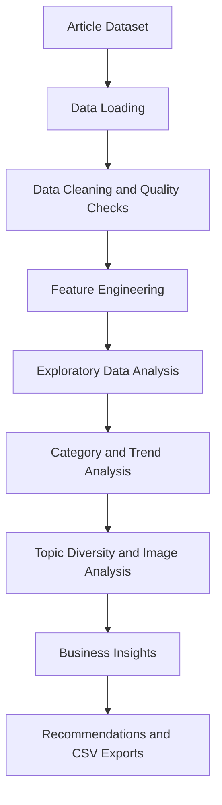

<div align="center">

# GeeksforGeeks Article Content Intelligence

**A Python data analytics project exploring content distribution, publishing trends, topic diversity, and editorial opportunities.**


</div>

---

## 📌 Project Overview

GeeksforGeeks publishes technical learning resources across programming, data structures and algorithms, web development, databases, AI, interview preparation, and other computing topics.

This project analyzes article-level metadata to understand how the content catalogue is organized and how its observed patterns change over time.

The goal is to turn raw article metadata into useful insights that can support content planning, taxonomy management, and editorial decision-making.

**Project objectives:**
- Identify the largest content categories.
- Measure category contribution and catalogue concentration.
- Analyze annual publishing patterns.
- Track category consistency and topic diversity.
- Compare image usage across technical subjects.
- Identify recent category-level changes.
- Translate analytical findings into actionable recommendations.

## 🎯 Business Questions

- Which categories contain the most article records?
- How concentrated is the catalogue among the leading categories?
- How has recorded content volume changed over time?
- Which categories appear consistently across multiple years?
- How has the diversity of observed categories evolved?
- How does image usage vary across technical subjects?
- Which categories show the largest changes between the latest observed years?
- What editorial opportunities should be investigated next?

## 🔄 Analytical Workflow



## 📊 Analysis Modules

| Module | Analysis | Business Value |
|---|---|---|
| Data Quality | Missing values, duplicate records, field availability | Establishes data reliability |
| Executive Snapshot | Dataset size, category coverage, and date coverage | Provides a quick overview |
| Category Portfolio | Category rankings and article shares | Identifies major content areas |
| Concentration Analysis | Category contribution and cumulative share | Measures dependence on leading categories |
| Annual Trends | Article volume by year and year-over-year change | Highlights historical patterns |
| Topic Mix | Leading category volume across years | Shows changes in subject distribution |
| Category Consistency | Active years and category-level volume | Identifies recurring content areas |
| Image Usage | Image counts and image presence by category | Compares visual content patterns |
| Topic Diversity | Unique categories observed each year | Tracks catalogue breadth |
| Recent Category Movement | Changes between the latest two available years | Identifies areas for further investigation |
| Broader Themes | Rule-based grouping of technical categories | Provides a higher-level content overview |
| Recommendations | Evidence-linked actions and validation metrics | Supports editorial planning |

## 📈 Key Results and Findings

The notebook calculates the actual metrics from the dataset when executed. The following are the main findings it is designed to produce.

### 1. Content Distribution
Identifies the categories with the highest article counts, their contribution to the catalogue, and the cumulative share represented by leading categories.

### 2. Catalogue Concentration
Measures whether article records are concentrated in a small number of categories or distributed across a broader range of topics.

### 3. Publishing Trends
Examines annual article volume and changes across the years represented in the dataset.

### 4. Category Consistency
Identifies categories that appear across multiple observed years and compares their overall article volume.

### 5. Topic Diversity
Tracks the number of unique categories recorded each year to understand how the breadth of the catalogue changes.

### 6. Recent Category Movement
Highlights categories with the largest absolute changes between the latest two available years.

### 7. Image Usage
Compares image counts and the share of articles containing images across categories.

### 8. Broader Technical Themes
Groups categories into wider subject areas using explicit classification rules, while retaining an unmapped group for categories that do not match the rules.

> Run the notebook to view the actual values, rankings, tables, and visualizations generated from the dataset.

## 💡 Business Insights and Recommendations

The following recommendations are hypotheses based on catalogue patterns. They should be validated with audience and performance data before making major content decisions.

| Observed Pattern | Recommended Action | Validation Metric |
|---|---|---|
| A few categories contribute a large share of article records | Review coverage, freshness, duplication, and missing subtopics in leading categories | Search impressions, clicks, content freshness |
| The catalogue contains many specialized categories | Review taxonomy consistency and improve navigation between related topics | Internal click-through rate, tag consistency |
| Category volume changes across years | Investigate major increases or decreases before changing publishing priorities | Comparable yearly data, search demand |
| Category diversity expands | Introduce a controlled taxonomy and review new category names | Unmapped-tag rate, duplicate tags |
| Image usage varies by subject | Assess whether diagrams and screenshots improve technical explanations | Usability testing, reader feedback |
| Some categories may have limited coverage | Compare catalogue coverage with actual learner needs before commissioning content | Search demand, traffic, content gaps |

### Recommended Business Next Step

Combine article metadata with performance metrics such as:

- Search impressions and clicks
- Click-through rate
- Page views and engagement
- Article freshness
- Search landing-page performance
- Reader feedback

This would help distinguish topics with high content volume from topics that actually attract readers or provide strong learning outcomes.

## 📊 Visualizations

The notebook generates analytical tables and charts covering:

- Category rankings
- Category contribution and cumulative share
- Annual publishing trends
- Category mix by year
- Category consistency
- Image usage by category
- Annual topic diversity
- Recent category movement
- Broader theme distribution

All chart outputs should be generated from the notebook's actual dataset rather than manually recreated from unverified figures.

## 🗂️ Dataset Overview

The project uses article-level metadata. Depending on the source file, relevant fields may include:

| Field | Purpose |
|---|---|
| Article title | Article-level reference |
| Category or tags | Category distribution and topic analysis |
| Last-updated date | Date-based analysis where usable |
| Year | Annual comparisons |
| Number of images | Visual-format analysis |

The notebook checks field availability and standardizes relevant fields before performing the analysis.

## 🛠️ Technology Stack

| Technology | Usage |
|---|---|
| Python | Data analysis and processing |
| Pandas | Data cleaning, grouping, and aggregation |
| NumPy | Numerical operations |
| Plotly | Interactive visualizations |
| Matplotlib | Statistical charts |
| Jupyter Notebook | Reproducible analysis environment |

## 🚀 How to Run the Project

### 1. Clone the repository

```bash
git clone https://github.com/Surajkumar-Analyst/GeeksforGeeks-Content-Trend-Analysis.git
cd GeeksforGeeks-Content-Trend-Analysis
```

### 2. Install dependencies

```bash
python -m pip install pandas numpy plotly matplotlib jupyter
```

### 3. Start Jupyter Notebook

```bash
jupyter notebook
```

### 4. Open the analysis notebook

Navigate to the `GFG-Trend-Analysis/notebook/` directory and open the notebook you want to run.

### 5. Configure the dataset

Ensure the CSV dataset is available at one of the paths configured in the notebook. If your file is stored elsewhere, update the dataset path near the beginning of the notebook.

### 6. Run all cells

Execute the notebook from top to bottom to generate the analysis, visualizations, recommendations, and output tables.

## 📁 Project Structure

```text
GeeksforGeeks-Content-Trend-Analysis/
└── GFG-Trend-Analysis/
    ├── Assets/
    │   └── project_banner.png
    ├── data/
    │   └── gfg_articles_clean_data.csv
    ├── notebook/
    │   ├── GFG_Articles_Analysis.ipynb
    │   └── GFG_Content_Intelligence_Professional.ipynb
    └── README.md
```

Update this structure if your committed filenames or folders differ.

## 📤 Generated Outputs

After running the redesigned notebook, the analysis is configured to export these CSV summaries into an `outputs/` directory:

| Output File | Contents |
|---|---|
| `data_quality_summary.csv` | Data quality summary |
| `category_performance.csv` | Category rankings and performance |
| `annual_content_volume.csv` | Annual article volume |
| `category_consistency.csv` | Category activity across years |
| `category_image_usage.csv` | Image usage by category |
| `annual_topic_diversity.csv` | Annual category diversity |
| `broader_theme_summary.csv` | Summary by broader theme |
| `content_strategy_recommendations.csv` | Recommendations and supporting evidence |

These are derived analytical outputs; the source dataset is not modified.

## ⚠️ Limitations

- Article counts measure catalogue volume, not readership or content quality.
- A last-updated date may not represent the original publication date.
- The latest year may be incomplete, making direct comparisons with full years misleading.
- Changes in tags and classification practices can affect measured category diversity.
- Broader theme groups use rule-based classification and may require editorial review.
- Image presence alone cannot establish whether images improve engagement or learning outcomes.
- Percentage changes can be unstable when the previous period has a small or zero count.

## 🔮 Future Enhancements

- Build an interactive dashboard for content monitoring.
- Integrate search and engagement data.
- Apply NLP-assisted topic classification.
- Improve taxonomy governance and category mapping.
- Automate recurring analysis and report generation.
- Evaluate content opportunities using demand, performance, and production effort.
- Add forecasting after validating the quality and coverage of historical data.

These are potential extensions, not claims about features already implemented.

## 🧠 Skills Demonstrated

**Data Analytics**
- Exploratory Data Analysis (EDA)
- Data cleaning and feature engineering
- Category ranking and concentration analysis
- Year-based trend analysis
- Data visualization and interpretation

**Business Analysis**
- Translating business questions into analytical tasks
- Identifying content portfolio patterns
- Developing evidence-based recommendations
- Defining validation metrics
- Communicating findings through data storytelling

**Python and Tools**
- Pandas and NumPy
- Plotly and Matplotlib
- Jupyter Notebook
- Reproducible analytical workflows
- CSV reporting and export

## 🤝 Feedback and Contributions

If you find this project useful, consider starring the repository or opening an issue with suggestions for improvement.

**Built with Python, data analytics, and curiosity about how technical learning content evolves.**
